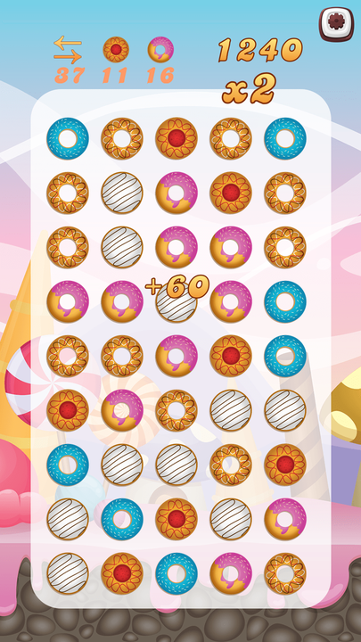
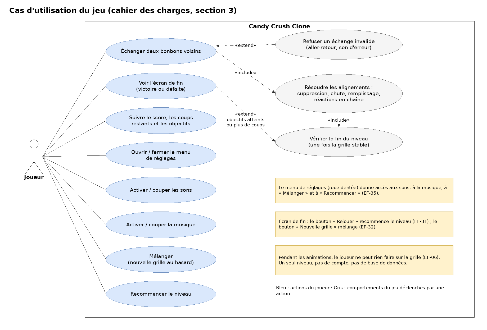
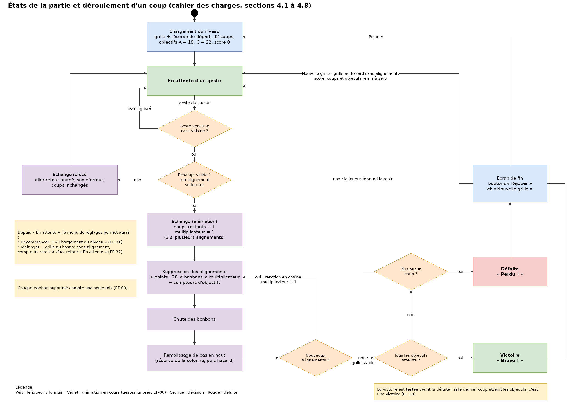
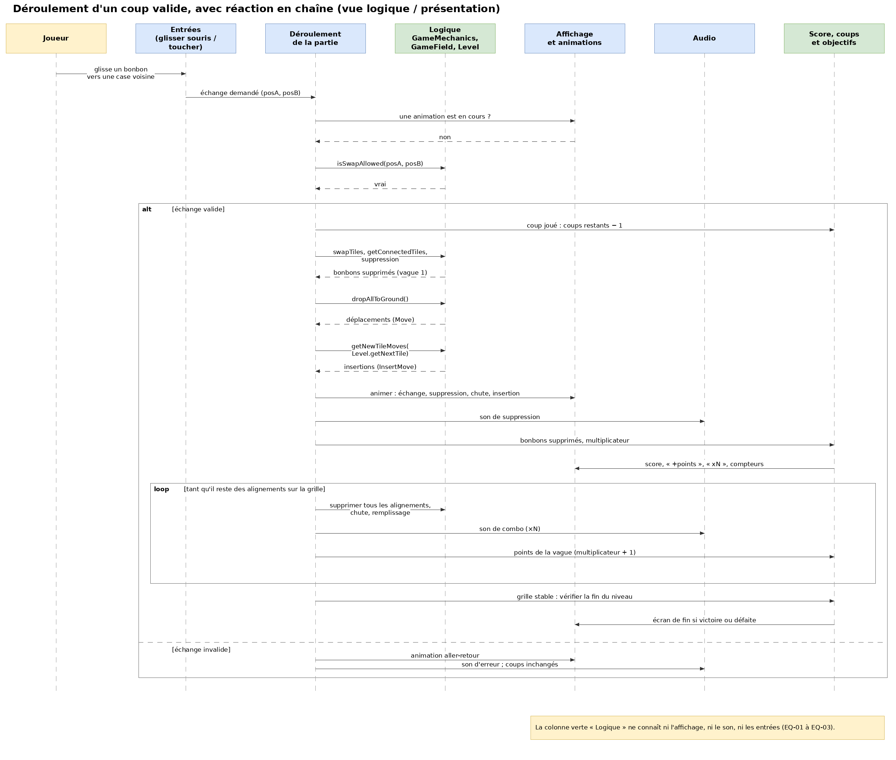
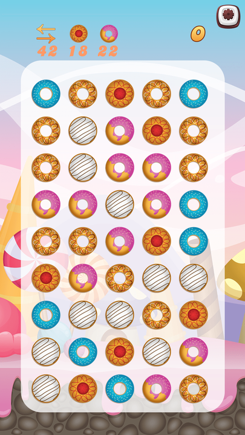
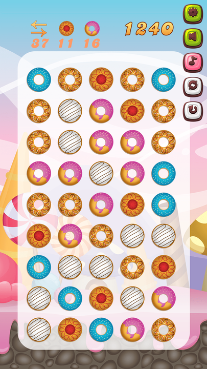
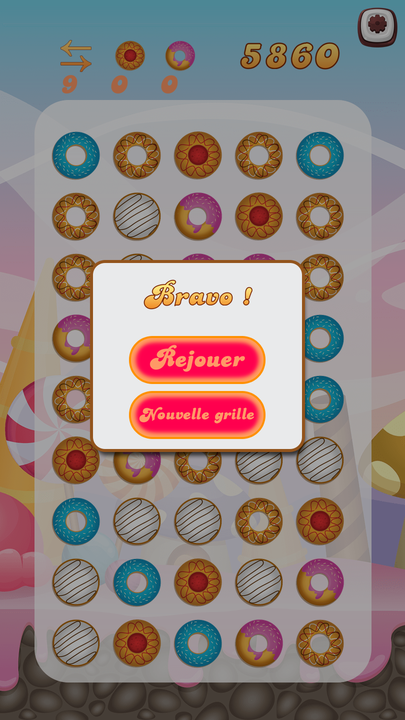
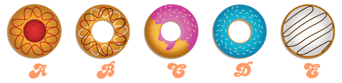
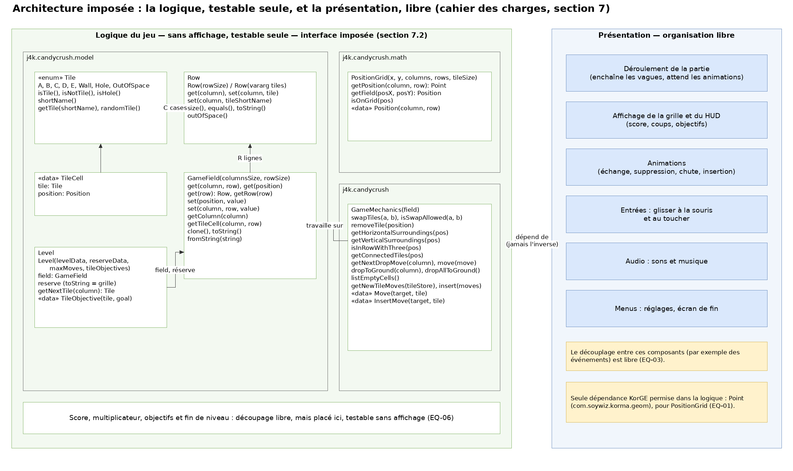

# Cahier des charges : jeu « Candy Crush Clone » (match 3)

| | |
|---|---|
| Version | 1.0 (25 novembre 2026) |
| Statut | Version de travail, à valider par l'équipe avant les essais officiels |
| Destinataire | L'outil de développement chargé de réaliser le jeu (document identique pour tous) |
| Figures | Captures et schémas dans le dossier docs/figures/ (voir les figures 1 à 9 ci-dessous) |

> Comment lire ce document. Chaque exigence porte un identifiant (`EF-…` fonctionnelle, `EI-…` interface imposée, `ET-…` technique, `EQ-…` qualité) et une priorité : Obligatoire, Souhaitable ou Optionnelle. Les critères d'acceptation de la section 9 reprennent ces identifiants : c'est sur eux que le résultat sera jugé. Quand le texte et un schéma ou une capture semblent se contredire, le texte fait foi.

---

## 1. Présentation

### 1.1 Le jeu en une phrase
Un jeu de type « match 3 » sur une grille de bonbons : le joueur échange deux bonbons voisins pour former des lignes d'au moins trois bonbons identiques, qui disparaissent et rapportent des points ; les bonbons du dessus tombent pour combler les trous, de nouveaux bonbons arrivent par le haut, et des réactions en chaîne peuvent se produire.

### 1.2 Objectif du joueur
Atteindre les objectifs du niveau (collecter un nombre donné de bonbons de certains types) avant d'avoir épuisé son nombre de coups. Le score sert de récompense et de retour visuel ; il ne conditionne pas la victoire.



*Figure 1 : le jeu attendu, en cours de partie (capture composée avec les ressources fournies)*

### 1.3 Périmètre
| Dans le périmètre | Hors périmètre |
|---|---|
| Un niveau fixe (grille, réserve, objectifs fournis en section 4.6) | Plusieurs niveaux, carte de progression, sauvegarde |
| Échange, alignements, chute, remplissage, réactions en chaîne | Bonbons spéciaux (rayés, bombes…), obstacles, murs |
| Score avec multiplicateur de réactions en chaîne | Classement, comptes joueurs, réseau |
| Objectifs de collecte et nombre de coups limité | Objectif de temps, score minimum à atteindre |
| Écran de fin (victoire / défaite), rejouer, nouvelle grille | Détection d'une grille bloquée (aucun coup possible) |
| Menu de réglages : sons, musique, mélanger, recommencer | Paramètres persistants d'une partie à l'autre |
| Commande à la souris et au toucher (glisser) | Clavier pour jouer (seulement des touches de débogage, optionnelles) |

Aucune base de données n'est attendue : tout l'état du jeu vit en mémoire.

---

## 2. Vocabulaire

| Terme | Définition |
|---|---|
| Grille | Tableau de cases de `C` colonnes et `R` lignes. Colonne 0 à gauche, ligne 0 en haut. Une position s'écrit `(colonne, ligne)`. |
| Case | Emplacement de la grille. Elle contient un bonbon (types `A` à `E`) ou un trou (`H`, case vide). |
| Hors grille | Valeur renvoyée quand on lit une position qui n'existe pas (`O`). Ce n'est jamais un contenu de case. |
| Mur | Type réservé (`W`), présent dans le modèle mais non utilisé dans le jeu (pas d'effet). |
| Voisins | Deux cases qui partagent un côté (même ligne et colonnes qui se suivent, ou même colonne et lignes qui se suivent). Les diagonales ne sont pas voisines. |
| Alignement | Suite d'au moins 3 bonbons identiques consécutifs sur une même ligne (horizontal) ou une même colonne (vertical). Un trou n'est jamais aligné avec quoi que ce soit, même avec d'autres trous. |
| Coup | Un échange valide de deux bonbons voisins. Un échange refusé ne compte pas comme un coup. |
| Vague | Une étape « suppression → chute → remplissage ». Le coup produit la première vague ; chaque nouvel alignement apparu tout seul après le remplissage produit une vague supplémentaire (réaction en chaîne). |
| Multiplicateur | Facteur appliqué aux points d'une vague (×1, ×2, ×3…). |
| Réserve | Petite grille de bonbons prédéfinis qui alimente le remplissage, colonne par colonne, avant de passer au hasard. |
| Notation texte d'une grille | Une ligne de grille par ligne de texte, entre crochets, cases séparées par des virgules : `[A, B, H]`. Les lignes sont séparées par un retour à la ligne (`\n`). |

---

## 3. Acteurs et cas d'utilisation
Le schéma ci-dessous résume les actions du joueur (en bleu) et ce que le jeu fait en réponse (en gris).



*Figure 2 : cas d'utilisation*

Un seul acteur : le joueur. Il peut :
1. échanger deux bonbons voisins (cas principal ; il déclenche la résolution des alignements et des réactions en chaîne) ;
2. suivre son score, ses coups restants et l'avancement des objectifs ;
3. ouvrir ou fermer le menu de réglages ;
4. activer ou couper les effets sonores ;
5. activer ou couper la musique ;
6. mélanger (obtenir une nouvelle grille au hasard) ;
7. recommencer le niveau ;
8. à la fin du niveau, choisir « Rejouer » ou « Nouvelle grille ».

---

## 4. Règles du jeu (exigences fonctionnelles)
Le schéma des états montre tout le cycle d'un coup, du geste du joueur jusqu'au retour en attente ou à l'écran de fin. Le schéma de déroulement montre qui fait quoi pendant un coup, et la séparation entre la logique et la présentation.



*Figure 3 : états de la partie*



*Figure 4 : déroulement d'un coup valide, avec réaction en chaîne*

### 4.1 Échanger deux bonbons

| ID | Exigence | Priorité |
|---|---|---|
| EF-01 | Le joueur appuie sur un bonbon et le fait glisser vers une case voisine (haut, bas, gauche ou droite). Le geste est pris en compte dès que le pointeur s'est éloigné d'au moins une taille de case du point de départ, ou quand il est relâché. La direction retenue est celle de la case d'arrivée du geste. | Obligatoire |
| EF-02 | Un geste dont la case de départ ou d'arrivée est hors de la grille, ou dont les deux cases ne sont pas voisines (diagonale, distance de 2 cases ou plus), est ignoré sans effet ni son. | Obligatoire |
| EF-03 | Un échange est valide si les deux cases contiennent des bonbons (pas de trou) et si, une fois les deux bonbons échangés, au moins l'un des deux se trouve dans un alignement (horizontal ou vertical). | Obligatoire |
| EF-04 | Échange invalide : les deux bonbons font un aller-retour animé (ils se croisent puis reviennent à leur place), un son d'erreur est joué, la grille ne change pas et le compteur de coups ne bouge pas. | Obligatoire |
| EF-05 | Échange valide : les deux bonbons échangent leur place (animation), le compteur de coups restants diminue de 1, puis la résolution des alignements démarre (4.2). | Obligatoire |
| EF-06 | Tant qu'une animation est en cours (échange, suppression, chute, remplissage, réaction en chaîne), tous les gestes du joueur sur la grille sont ignorés. | Obligatoire |

### 4.2 Supprimer les alignements

| ID | Exigence | Priorité |
|---|---|---|
| EF-07 | Après un échange valide, on supprime tous les alignements qui passent par l'une des deux cases échangées, horizontaux et verticaux, quelle que soit leur longueur (3, 4, 5, 6 bonbons ou plus). Un alignement en L ou en T (une ligne et une colonne qui se croisent) est supprimé en entier. | Obligatoire |
| EF-08 | Supprimer un bonbon, c'est mettre un trou à sa place. La suppression est animée (le bonbon disparaît en environ 0,2 s) et accompagnée d'un son de suppression. | Obligatoire |
| EF-09 | Chaque bonbon supprimé compte une seule fois pour le score et pour les objectifs, même s'il appartient à la fois à un alignement horizontal et à un alignement vertical. | Obligatoire |

### 4.3 Faire tomber les bonbons et remplir

| ID | Exigence | Priorité |
|---|---|---|
| EF-10 | Chute : dans chaque colonne, les bonbons situés au-dessus d'un trou descendent jusqu'à reposer sur un autre bonbon ou sur le bas de la grille. L'ordre vertical des bonbons d'une colonne est conservé. Après la chute, dans chaque colonne, tous les trous sont au-dessus de tous les bonbons. | Obligatoire |
| EF-11 | La chute est animée ; la durée est proportionnelle au nombre de lignes parcourues (ordre de grandeur : 0,5 s par ligne). | Souhaitable |
| EF-12 | Remplissage : chaque trou restant reçoit un nouveau bonbon. Les cases sont remplies de bas en haut (les lignes les plus basses d'abord). Le bonbon donné à une case de la colonne `c` est le prochain bonbon de la colonne `c` fourni par le niveau (4.6 : réserve, puis hasard). | Obligatoire |
| EF-13 | Les nouveaux bonbons apparaissent par le haut de leur colonne et tombent jusqu'à leur case (animation avec apparition en fondu). | Souhaitable |

### 4.4 Réactions en chaîne

| ID | Exigence | Priorité |
|---|---|---|
| EF-14 | Après chaque remplissage, le jeu cherche les alignements sur toute la grille. S'il en trouve, il les supprime tous en même temps, puis refait chute et remplissage : c'est une nouvelle vague. On recommence jusqu'à ce que la grille ne contienne plus aucun alignement. | Obligatoire |
| EF-15 | À chaque vague de réaction en chaîne, un son de « combo » est joué, différent selon le niveau du multiplicateur (×2, ×3, ×4, ×5, puis le même son pour ×6 et au-delà). | Souhaitable |
| EF-16 | Le joueur ne reprend la main qu'une fois la grille stable (plus aucun alignement, plus aucune animation). | Obligatoire |

### 4.5 Score et multiplicateur

| ID | Exigence | Priorité |
|---|---|---|
| EF-17 | Points d'une vague = nombre de bonbons supprimés dans la vague × 20 × multiplicateur. | Obligatoire |
| EF-18 | Multiplicateur : la première vague d'un coup vaut ×1, ou ×2 si l'échange a formé plusieurs alignements d'un coup (par exemple un horizontal et un vertical, ou un alignement pour chacun des deux bonbons échangés). Chaque vague de réaction en chaîne ajoute +1 au multiplicateur de la vague précédente. Le multiplicateur repart de zéro à chaque nouveau coup. | Obligatoire |
| EF-19 | Le score total (somme de tous les points de la partie) est affiché en permanence en haut à droite et mis à jour à chaque vague. Il démarre à 0. | Obligatoire |
| EF-20 | À chaque vague, les points gagnés s'affichent à l'endroit des bonbons supprimés (au niveau du bonbon du milieu du groupe), montent légèrement (environ 60 px) et s'effacent en environ 1 s. | Souhaitable |
| EF-21 | Quand le multiplicateur d'une vague dépasse 1, le texte « x2 », « x3 »… s'affiche en grand sous le score, puis s'efface en environ 1,5 s. | Souhaitable |

### 4.6 Le niveau

| ID | Exigence | Priorité |
|---|---|---|
| EF-22 | Le jeu contient un niveau, défini par les données ci-dessous (à reprendre telles quelles) : une grille de départ de 5 colonnes × 9 lignes, une réserve de 5 colonnes × 2 lignes, 42 coups, et deux objectifs : collecter 18 bonbons A et 22 bonbons C. | Obligatoire |
| EF-23 | Prochain bonbon d'une colonne : on prend le bonbon le plus bas de la même colonne de la réserve, on le retire de la réserve (il devient un trou) et les bonbons restants de cette colonne de réserve descendent d'une case. Quand la colonne de réserve est vide, le prochain bonbon est tiré au hasard (uniformément parmi A, B, C, D, E). | Obligatoire |
| EF-24 | Un niveau doit pouvoir être décrit en notation texte (grille, réserve), pour le créer facilement et pour l'utiliser dans les tests. | Obligatoire |

Grille de départ (ligne 0 en haut) :
```
[D,B,A,B,D]
[B,E,C,A,B]
[B,E,C,C,B]
[C,C,E,C,D]
[B,B,C,A,D]
[A,C,B,E,E]
[D,E,E,B,A]
[E,D,A,E,C]
[E,A,D,C,B]
```


*Figure 5 : la grille de départ du niveau, telle qu'elle doit s'afficher au lancement*

Réserve (ligne 0 en haut ; le bonbon le plus bas de chaque colonne sort en premier) :
```
[E,C,B,A,D]
[D,A,E,C,B]
```

### 4.7 Objectifs, fin de niveau

| ID | Exigence | Priorité |
|---|---|---|
| EF-25 | Pour chaque objectif, le jeu affiche l'image du bonbon concerné et le nombre de bonbons qu'il reste à collecter (objectif − bonbons de ce type supprimés depuis le début, jamais en dessous de 0). Tous les bonbons supprimés comptent, y compris ceux des réactions en chaîne. | Obligatoire |
| EF-26 | Le jeu affiche le nombre de coups restants (42 au départ, jamais en dessous de 0). | Obligatoire |
| EF-27 | La fin du niveau est vérifiée après chaque coup, une fois la grille stable (après la dernière vague de réaction en chaîne). | Obligatoire |
| EF-28 | Victoire : chaque objectif est atteint, c'est-à-dire que le nombre de bonbons collectés est supérieur ou égal à l'objectif (le compteur affiché est à 0). La victoire l'emporte si elle arrive au même coup que le dernier coup disponible. | Obligatoire |
| EF-29 | Défaite : il ne reste plus aucun coup et au moins un objectif n'est pas atteint. | Obligatoire |
| EF-30 | En cas de victoire ou de défaite, un écran de fin s'affiche par-dessus la grille (fenêtre centrée) avec un titre qui distingue les deux cas (« Bravo ! » pour la victoire, « Perdu ! » pour la défaite) et deux boutons : « Rejouer » et « Nouvelle grille ». Tant qu'il est affiché, la grille ne réagit plus aux gestes. | Obligatoire |

### 4.8 Rejouer, mélanger

| ID | Exigence | Priorité |
|---|---|---|
| EF-31 | Rejouer / Recommencer : recharge le niveau d'origine (grille et réserve de départ), remet à zéro le score, le compteur de coups, les compteurs d'objectifs et le multiplicateur, arrête les animations en cours et ferme l'écran de fin. | Obligatoire |
| EF-32 | Nouvelle grille / Mélanger : remplace chaque case par un bonbon tiré au hasard, en retirant le tirage tant que le bonbon forme un alignement avec ses voisins déjà placés, afin que la nouvelle grille ne contienne aucun alignement. Remet à zéro score, coups et objectifs (mêmes objectifs que le niveau) et ferme l'écran de fin. | Obligatoire |

---

## 5. Écrans et interactions
Les captures de cette section sont composées avec les ressources fournies (section 6.1), aux positions décrites ci-dessous. Elles montrent le rendu attendu ; le texte fait foi.

| ID | Exigence | Priorité |
|---|---|---|
| EF-33 | Le jeu tient dans une seule scène en mode portrait. Résolution virtuelle 810 × 1440, projetée dans une fenêtre de 540 × 960 au lancement sur PC. Titre de la fenêtre : « Candy Crush ». | Obligatoire |
| EF-34 | Disposition : image de fond plein écran ; en haut à gauche, l'icône des coups suivie du nombre de coups restants, puis, pour chaque objectif, l'image du bonbon et le nombre restant ; en haut à droite, le score total ; à droite, le bouton de réglages (roue dentée) ; au centre, la grille, centrée horizontalement et commençant à environ 250 px du haut (en résolution virtuelle), avec des cases carrées aussi grandes que possible. Les bonbons occupent environ 85 % de leur case. | Obligatoire |
| EF-35 | Menu de réglages : un clic sur la roue dentée ouvre ou ferme une colonne de 4 boutons placée dessous : sons (activé au démarrage), musique (coupée au démarrage), mélanger (EF-32), recommencer (EF-31). Les boutons « sons » et « musique » changent d'image selon leur état. Les boutons ont un état « survol » et « clic » quand des images sont fournies. | Obligatoire |
| EF-36 | Sons : un son de suppression (après un échange valide), un son d'erreur (échange invalide), des sons de combo (EF-15). Couper les sons les rend tous muets immédiatement. | Obligatoire |
| EF-37 | Musique : quand elle est activée, les morceaux fournis sont joués l'un après l'autre en boucle ; quand elle est coupée, la musique s'arrête. | Souhaitable |
| EF-38 | Le jeu se joue de la même façon à la souris et au toucher (écran tactile). | Obligatoire |
| EF-39 | Touches de débogage (développeur, pas pour le joueur) : `P` affiche la grille en notation texte dans la console, `D` remplace les bonbons par des images de lettres A–E, `S` mélange, `R` recommence. | Optionnelle |

---





*Figure 6 : menu de réglages ouvert (à gauche) et écran de fin en cas de victoire (à droite)*


*Figure 7 : écran de fin en cas de défaite*

## 6. Contraintes techniques imposées

Ces contraintes servent à ce que toutes les réalisations soient comparables. Elles ne sont pas négociables.

| ID | Exigence | Priorité |
|---|---|---|
| ET-01 | Langage Kotlin, projet Kotlin multiplateforme construit avec le moteur de jeu KorGE 3.4.0 (plugin Gradle `com.soywiz.korge` 3.4.0, paquets `com.soywiz.*`). Ne pas changer de version de KorGE ni de Kotlin. | Obligatoire |
| ET-02 | Gradle 7.5 (wrapper fourni) et JDK 17. | Obligatoire |
| ET-03 | Cible JVM (PC) obligatoire : `./gradlew runJvm` lance le jeu, `./gradlew jvmTest` lance les tests. Les cibles web et Android déjà déclarées dans la configuration fournie peuvent rester, mais ne sont pas évaluées. | Obligatoire |
| ET-04 | Point de départ fourni : un projet qui contient seulement la configuration Gradle (wrapper, `settings.gradle.kts`, `build.gradle.kts`, `gradle/libs.versions.toml`, `gradle.properties`), l'icône et le dossier de ressources `src/commonMain/resources/` (section 6.1). Les dossiers de code `src/commonMain/kotlin` et `src/commonTest/kotlin` sont vides. La configuration Gradle ne doit être modifiée qu'en cas de nécessité, en expliquant pourquoi. | Obligatoire |
| ET-05 | Code de la logique du jeu dans le paquet racine `j4k.candycrush` et ses sous-paquets imposés par la section 7. Le reste du code (affichage, audio, entrées) est libre, mais doit aussi rester sous `j4k.candycrush`. | Obligatoire |
| ET-06 | Le projet doit compiler et les tests passer sans avertissement bloquant, à partir d'un clone propre, avec les deux commandes de ET-03. | Obligatoire |
| ET-07 | Pas de dépendance externe supplémentaire sans justification écrite (dans le README). | Souhaitable |

### 6.1 Ressources fournies (dans `src/commonMain/resources/`)

| Fichier | Usage |
|---|---|
| `images/background.png` | Image de fond |
| `images/candy_donuts.png` | Planche des bonbons : 1060 × 848 px, 5 colonnes × 4 lignes de cases de 212 px, numérotées de 1 à 20 de gauche à droite puis de haut en bas. Bonbons du jeu : A = case 14, B = case 8, C = case 5, D = case 10, E = case 16. |
| `images/candy_fruits.png` | Autre planche (même format), non utilisée par défaut (thème optionnel) |
| `images/test_fruits.png` | Planche de débogage (lettres), 4 × 2 cases de 212 px (EF-39) |
| `images/gui_settings*.png`, `gui_sound_on/off.png`, `gui_music_on/off.png`, `gui_shuffle*.png`, `gui_restart*.png` | Boutons du menu de réglages (états normal / survol / clic / activé) |
| `images/text_arrows_move.png` | Icône du compteur de coups |
| `images/message_box.9.png`, `images/button.9.png`, `images/button.png` | Fenêtre et boutons de l'écran de fin (`.9.png` = image extensible « nine-patch ») |
| `fonts/candy.fnt` (+ `.png`), `fonts/candy-small.fnt` (+ `.png`) | Polices bitmap : grande (score, titres) et petite (compteurs, boutons). Elles ne contiennent que les caractères ASCII, sans accents : les textes affichés avec ces polices s'écrivent sans accent (d'où « Bravo ! » et « Perdu ! »). |
| `sounds/clear.mp3`, `wrong_move.mp3`, `multi_2.mp3` … `multi_6.mp3`, `drop_ground.mp3` | Effets sonores (suppression, erreur, combos ×2 à ×6, chute) |
| `music/monkey_drama.mp3`, `music/monkey_island_puzzler.mp3` | Musique |

---



*Figure 8 : les cinq bonbons du jeu, de A à E, tirés de la planche candy_donuts.png*

## 7. Architecture et interface imposée de la logique



*Figure 9 : architecture imposée, logique testable seule et présentation libre*

### 7.1 Séparation logique / présentation

| ID | Exigence | Priorité |
|---|---|---|
| EQ-01 | La logique du jeu (modèle de la grille, règles, niveau) est séparée de la présentation (affichage, animations, entrées, audio). Elle ne dépend d'aucune classe d'affichage, de son ou de saisie de KorGE. Seule exception autorisée : le type `Point` de `com.soywiz.korma.geom` (bibliothèque de géométrie), utilisé par `PositionGrid`. | Obligatoire |
| EQ-02 | La logique est testable sans lancer le jeu ni ouvrir de fenêtre : on peut créer une grille à partir d'une chaîne de texte, jouer des actions et vérifier le résultat. | Obligatoire |
| EQ-03 | La présentation dépend de la logique, jamais l'inverse. Le découplage entre composants (par exemple par des événements) est libre. | Obligatoire |

### 7.2 Interface publique imposée (contrat)

Les classes et membres ci-dessous doivent exister avec exactement ces noms, paquets, paramètres et types, et respecter le comportement décrit. Des tests automatiques indépendants appelleront directement cette interface. Tout le reste (membres privés, classes supplémentaires, découpage interne) est libre. Les noms de paramètres comptent (les tests utilisent des arguments nommés comme `column = 1`).

#### Paquet `j4k.candycrush.model`

`enum class Tile` : valeurs, dans cet ordre : `A, B, C, D, E, Wall, Hole, OutOfSpace`.
- `fun isTile(): Boolean` : vrai pour `A` à `E`, faux pour `Wall`, `Hole`, `OutOfSpace`.
- `fun isNotTile(): Boolean` : contraire de `isTile()`.
- `fun isHole(): Boolean` : vrai seulement pour `Hole`.
- `fun shortName(): String` : la première lettre du nom (`"A"`… `"E"`, `"W"`, `"H"`, `"O"`).
- Dans le `companion object` : `fun getTile(shortName: String): Tile` (inverse de `shortName()`, lève `IllegalArgumentException` pour une lettre inconnue) et `fun randomTile(): Tile` (un bonbon au hasard parmi `A` à `E`).

`data class TileCell(val tile: Tile, val position: PositionGrid.Position)` : un bonbon et sa position.

`class Row` : une ligne de la grille.
- `constructor(rowSize: Int)` : ligne de `rowSize` cases, toutes à `Hole`.
- `constructor(vararg tiles: Tile)` : ligne contenant ces cases, dans l'ordre.
- `operator fun get(column: Int): Tile` : la case, ou `OutOfSpace` si `column` est hors de la ligne.
- `operator fun set(column: Int, tile: Tile)` et `operator fun set(column: Int, tileShortName: String)` (lettre, par exemple `"E"`).
- `fun size(): Int`.
- `equals` / `hashCode` : deux lignes sont égales si elles ont le même contenu.
- `toString()` : notation texte, par exemple `[A, H, B]` (virgule et espace entre les cases).
- `companion object { fun outOfSpace(): Row }` : ligne renvoyée quand on demande une ligne hors de la grille ; toute lecture dedans renvoie `OutOfSpace` ; deux appels renvoient des lignes égales.

`class GameField(val columnsSize: Int, val rowSize: Int)` : la grille (`columnsSize` colonnes, `rowSize` lignes), toutes les cases à `Hole` au départ.
- `operator fun get(column: Int, row: Int): Tile` et `operator fun get(position: PositionGrid.Position): Tile` : `OutOfSpace` hors grille.
- `operator fun get(row: Int): Row` et `fun getRow(row: Int): Row` : la ligne (modifiable : `field[1][2] = "B"` change la grille), ou `Row.outOfSpace()` hors grille. Attention : `field[ligne][colonne]` (ligne d'abord) alors que `field.get(column, row)` (colonne d'abord).
- `operator fun set(position: PositionGrid.Position, value: Tile)` et `operator fun set(column: Int, row: Int, value: Tile)`.
- `fun getColumn(column: Int): List<Tile>` : la colonne de haut en bas ; lève `IllegalArgumentException` si `column` est hors de la grille.
- `fun getTileCell(column: Int = 0, row: Int = 0): TileCell` et `fun getTileCell(position: PositionGrid.Position): TileCell`.
- `fun clone(): GameField` : copie indépendante (modifier la copie ne modifie pas l'original).
- `toString()` : notation texte, lignes séparées par `\n`, sans retour à la ligne final, par exemple `"[A, H]\n[H, B]"`.
- `companion object { fun fromString(string: String): GameField }` : lit la notation texte ; doit accepter les cases avec ou sans espaces (`[A, B]` comme `[A,B]`) et ignorer l'indentation et les lignes vides.

`class Level(levelData: String, reserveData: String? = null, …)` : le niveau. Les deux premiers paramètres sont imposés (dans cet ordre, `Level(grille, réserve)` doit compiler) ; les suivants (nombre de coups, objectifs…) sont libres, mais doivent avoir une valeur par défaut.
- `val field: GameField` : la grille de jeu, lue depuis `levelData`.
- `val reserve` (type libre, par exemple `GameField?`) : la réserve ; son `toString()` donne la réserve actuelle en notation texte.
- `data class TileObjective(val tile: Tile, val goal: Int)`.
- `fun getNextTile(column: Int): Tile` : renvoie le prochain bonbon de la colonne et met à jour la réserve (règle EF-23). Exemple : avec la réserve `[B, D, E, A]` / `[A, B, D, E]`, deux appels `getNextTile(0)` renvoient `A` puis `B`, et la réserve devient `[H, D, E, A]` / `[H, B, D, E]`.

#### Paquet `j4k.candycrush.math`

`class PositionGrid(val x: Int = 0, val y: Int = 0, val columns: Int, val rows: Int, val tileSize: Int)` : correspondance entre les cases et les pixels à l'écran (grille dont le coin haut-gauche est en `(x, y)` et dont les cases font `tileSize` pixels).
- `data class Position(val column: Int = 0, val row: Int = 0)` (classe imbriquée : `PositionGrid.Position`).
- `fun getPosition(column: Int, row: Int): com.soywiz.korma.geom.Point` : coin haut-gauche de la case en pixels, soit `(x + column × tileSize, y + row × tileSize)`, sans vérifier que la case existe.
- `fun getField(posX: Int, posY: Int): Position` : case qui contient le pixel `(posX, posY)` (division entière des coordonnées relatives au coin de la grille).
- `fun isOnGrid(pos: Position): Boolean` : vrai si `0 ≤ column < columns` et `0 ≤ row < rows`.

#### Paquet `j4k.candycrush`

`class GameMechanics(val field: GameField)` : les actions et vérifications sur une grille. Toutes les méthodes travaillent directement sur `field` (pas de copie). `toString()` renvoie `field.toString()`.
- `fun swapTiles(a: Position, b: Position)` : échange le contenu des deux cases.
- `fun isSwapAllowed(a: Position, b: Position): Boolean` : vrai si l'échange est valide (EF-03) ; la grille est identique avant et après l'appel.
- `fun removeTile(position: Position)` : met un `Hole` à cette position.
- `fun getHorizontalSurroundings(pos: Position): List<TileCell>` : les cases de la ligne de `pos` qui forment une suite continue de bonbons du même type que celui de `pos`, case de `pos` comprise, triées de gauche à droite. Si la case de `pos` n'est pas un bonbon (trou…), renvoie une liste contenant seulement cette case. La longueur n'est pas limitée (une suite de 6 renvoie 6 cases).
- `fun getVerticalSurroundings(pos: Position): List<TileCell>` : même chose sur la colonne, triée de haut en bas.
- `fun isInRowWithThree(pos: Position): Boolean` : vrai si la case de `pos` fait partie d'un alignement (suite horizontale ou verticale d'au moins 3).
- `fun getConnectedTiles(pos: Position): List<TileCell>` : l'alignement vertical passant par `pos` (s'il fait au moins 3 cases, sinon rien), suivi de l'alignement horizontal passant par `pos` (même condition). Si `pos` est au croisement des deux, sa case apparaît donc deux fois. Liste vide si aucun alignement (et toujours vide pour un trou).
- `fun getNextDropMove(column: Int): Move?` : en parcourant la colonne du bas vers le haut, trouve le premier trou, puis le premier bonbon situé au-dessus de ce trou ; renvoie le déplacement de ce bonbon vers ce trou, ou `null` si aucun bonbon de la colonne n'a de trou en dessous.
- `fun move(move: Move)` : met le bonbon de `move.tile` dans `move.target`, et un trou en `move.tile`.
- `fun dropToGround(column: Int): List<Move>` : applique `getNextDropMove` + `move` sur la colonne jusqu'à ce qu'il n'y ait plus rien à faire, et renvoie les déplacements effectués, dans l'ordre (règle EF-10).
- `fun dropAllToGround(): List<Move>` : la même chose pour toutes les colonnes, de gauche à droite.
- `fun listEmptyCells(): List<Position>` : positions de tous les trous de la grille.
- `fun getNewTileMoves(tileStore: (Int) -> Tile): List<InsertMove>` : un `InsertMove` par trou, triés de la ligne la plus basse à la plus haute ; le bonbon de chaque insertion est obtenu en appelant `tileStore(colonne du trou)`, dans cet ordre (EF-12). Ne modifie pas la grille.
- `fun insert(moves: List<InsertMove>)` : place chaque bonbon à sa position cible.
- `data class Move(val target: Position, val tile: Position)` : attention à l'ordre : `target` = case d'arrivée (le trou), `tile` = case de départ du bonbon.
- `data class InsertMove(val target: Position, val tile: Tile) : Comparable<InsertMove>` : l'ordre naturel (`sorted()`) range les insertions de la ligne la plus basse (numéro le plus grand) à la plus haute.

(`Position` désigne ici `j4k.candycrush.math.PositionGrid.Position`.)

---

## 8. Exigences de qualité et livrables

| ID | Exigence | Priorité |
|---|---|---|
| EQ-04 | Tests unitaires écrits par le réalisateur dans `src/commonTest/kotlin` (sous-dossier ou paquet libre), qui couvrent au minimum : la notation texte (lecture, écriture), les accès hors grille, l'échange, la validité d'un échange, la détection des alignements (3, plus de 3, horizontal, vertical, croisement, trous), la chute, le remplissage et son ordre, la réserve du niveau, le score et le multiplicateur, la victoire et la défaite. Ils passent avec `./gradlew jvmTest`. | Obligatoire |
| EQ-05 | Les tests ne dépendent ni du hasard ni de l'affichage (une source de bonbons déterministe doit pouvoir être injectée, comme le paramètre `tileStore`). | Obligatoire |
| EQ-06 | Le calcul du score, du multiplicateur et de la fin de niveau (EF-17 à EF-29) est placé dans du code testable sans affichage, comme le reste de la logique. | Souhaitable |
| EQ-07 | Un README explique : comment lancer le jeu et les tests, l'organisation du code (rôle de chaque paquet et classe principale), les choix faits là où ce document laisse la liberté, et les écarts éventuels par rapport à ce document. | Obligatoire |
| EQ-08 | Les classes et méthodes publiques ont un commentaire de documentation (KDoc) d'une ou deux phrases. | Souhaitable |
| EQ-09 | Code lisible : noms explicites, fonctions courtes, pas de code mort ni de code commenté laissé en place, pas de valeur « magique » non nommée pour les règles (20 points par bonbon, 3 bonbons minimum, 42 coups…). | Souhaitable |
| EQ-10 | Robustesse : aucune entrée du joueur (geste hors grille, gestes très rapides, clics répétés pendant une animation, clic sur un trou) ne doit faire planter le jeu ni corrompre la grille (bonbon dupliqué ou disparu sans suppression). | Obligatoire |

Livrables : le code source complet du projet (qui compile), les tests, le README. Le résultat doit pouvoir être cloné et lancé directement avec les commandes de ET-03.

---

## 9. Critères d'acceptation

Chaque ligne se vérifie par oui / non. « Tests » = tests automatiques ; « Manuel » = vérification en jouant.

### 9.1 Construction
| # | Critère | Vérif. | Exigences |
|---|---|---|---|
| CA-01 | `./gradlew jvmTest` termine en BUILD SUCCESSFUL depuis un clone propre (JDK 17). | Manuel | ET-01 à ET-06 |
| CA-02 | `./gradlew runJvm` ouvre la fenêtre du jeu, en portrait, titre « Candy Crush ». | Manuel | ET-03, EF-33 |
| CA-03 | La version de KorGE, de Kotlin et de Gradle n'a pas été changée. | Revue | ET-01, ET-02, ET-04 |

### 9.2 Interface imposée et règles (tests indépendants)
| # | Critère | Vérif. | Exigences |
|---|---|---|---|
| CA-04 | Une batterie de tests indépendants, écrite contre l'interface de la section 7.2, compile sans modification sur le projet. | Tests | EI (section 7.2) |
| CA-05 | Ces tests passent (le pourcentage de réussite est mesuré). Ils portent sur : `Tile`, `Row`, `GameField` (notation texte, accès, hors grille, copie, colonnes), `GameMechanics` (échange, suppression, alignements, suites de 6, trous, chute, déplacements, insertion et son ordre, trous listés), `Level` (réserve) et `PositionGrid`. | Tests | EF-03, EF-07, EF-10, EF-12, EF-23, EF-24, section 7.2 |

### 9.3 Jeu (vérification manuelle, mêmes scénarios pour tous)
| # | Critère | Vérif. | Exigences |
|---|---|---|---|
| CA-06 | Au lancement, la grille de départ de la section 4.6 s'affiche à l'identique, avec 42 coups, objectifs A = 18 et C = 22, score 0. | Manuel | EF-22, EF-25, EF-26, EF-34 |
| CA-07 | Un échange qui ne forme aucun alignement fait un aller-retour, joue le son d'erreur et ne retire aucun coup. | Manuel | EF-04 |
| CA-08 | Un glisser en diagonale, vers une case à 2 cases ou en dehors de la grille ne fait rien. | Manuel | EF-02 |
| CA-09 | Un échange valide retire un coup, supprime l'alignement, fait tomber les bonbons et remplit la grille par le haut. | Manuel | EF-05, EF-07, EF-10, EF-12 |
| CA-10 | Les premiers bonbons ajoutés dans une colonne sont ceux de la réserve (du bas vers le haut), puis viennent des bonbons au hasard. | Manuel / Tests | EF-23 |
| CA-11 | Une réaction en chaîne se résout toute seule, affiche « x2 », « x3 »… et donne les bons points (20 × bonbons × multiplicateur). | Manuel / Tests | EF-14, EF-17, EF-18, EF-21 |
| CA-12 | Pendant les animations, les gestes sont ignorés ; des gestes rapides et répétés ne font ni planter le jeu ni apparaître d'incohérence. | Manuel | EF-06, EQ-10 |
| CA-13 | Quand les deux compteurs d'objectifs arrivent à 0, l'écran « Bravo ! » s'affiche (une fois la grille stable). | Manuel / Tests | EF-27, EF-28, EF-30 |
| CA-14 | Quand les coups arrivent à 0 sans avoir atteint les objectifs, l'écran « Perdu ! » s'affiche. | Manuel / Tests | EF-29, EF-30 |
| CA-15 | « Rejouer » remet la grille, la réserve, le score, les coups et les objectifs de départ. | Manuel | EF-31 |
| CA-16 | « Nouvelle grille » et « Mélanger » donnent une grille sans aucun alignement et remettent les compteurs à zéro. | Manuel / Tests | EF-32 |
| CA-17 | Le menu de réglages s'ouvre et se ferme ; sons (activés au départ) et musique (coupée au départ) s'activent et se coupent. | Manuel | EF-35, EF-36, EF-37 |
| CA-18 | Le jeu se joue au toucher (test sur écran tactile ou émulation tactile du navigateur / de l'OS). | Manuel | EF-38 |

### 9.4 Qualité
| # | Critère | Vérif. | Exigences |
|---|---|---|---|
| CA-19 | La logique (paquets `model`, `math` et `GameMechanics`, plus score et fin de niveau) n'importe aucune classe d'affichage, d'audio ou d'entrée de KorGE. | Revue | EQ-01, EQ-03, EQ-06 |
| CA-20 | Les tests du réalisateur existent, passent, ne dépendent pas du hasard et couvrent la liste de EQ-04. Leur couverture de code et leur taux de mutations détectées sont mesurés. | Tests / Revue | EQ-04, EQ-05 |
| CA-21 | Le README existe et contient les informations de EQ-07. | Revue | EQ-07 |
| CA-22 | L'analyse statique du code (outil fixé par l'équipe d'évaluation, par exemple detekt) est mesurée ; ce n'est pas un critère éliminatoire. | Mesure | EQ-08, EQ-09 |

---

## Annexe : glossaire de la notation texte

| Lettre | Signification |
|---|---|
| `A` `B` `C` `D` `E` | Les 5 types de bonbons |
| `H` | Trou (case vide) |
| `W` | Mur (réservé, non utilisé) |
| `O` | Hors grille (valeur de lecture seulement) |
